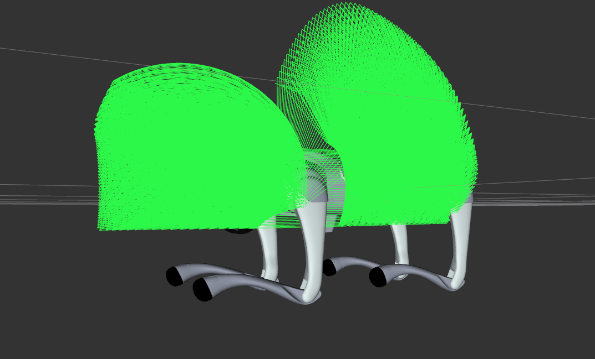

# cmake使用

## 设置一个变量SOURCES 
```
set(SOURCES
    src/main.cpp
    src/controller.cpp
    src/sensor_reader.cpp
    src/path_planner.cpp
)
```
## 将源文件变量集合编译为可执行文件
```
add_executable(hello ${SOURCES})
```
## 指定编译时的头文件的搜索路径
PUBLIC：这些头文件路径可以被传递到链接该库的其他目标使用
$<BUILD_INTERFACE:${CMAKE_CURRENT_SOURCE_DIR}/include>：构建时使用当前源码目录下的 include 文件夹
$<INSTALL_INTERFACE:include/${PROJECT_NAME}>：安装后使用 include/${PROJECT_NAME} 路径
```
target_include_directories(sub_node
        PUBLIC
        "$<BUILD_INTERFACE:${CMAKE_CURRENT_SOURCE_DIR}/include>"
        "$<INSTALL_INTERFACE:include/${PROJECT_NAME}>")
```
## ament 构建系统提供的函数，用于声明目标依赖的 ROS 包
PUBLIC：链接该库的目标也会自动依赖这些包
```
ament_target_dependencies(
        sub_node PUBLIC 
        rclcpp
        std_msgs
)
```
## install安装头文件
将 include/ 目录下的所有内容复制到 install/include/${PROJECT_NAME} 下（系统安装路径通常是 /usr/local/include 或工作空间 install 目录）。这样其他包通过 find_package 就能找到该工程的公共头文件
```
install(
    DIRECTORY include/
    DESTINATION include/${PROJECT_NAME}
)
```
## install安装其他文件
将 meshes、xacro、launch、config、urdf 这五个目录（及其中的所有内容）复制到 ROS 2 工作空间的安装目录下 share/${PROJECT_NAME}/ 中，以便在运行时通过包名访问这些资源文件
```
install(
		DIRECTORY meshes xacro launch config urdf
		DESTINATION share/${PROJECT_NAME}/
)
```
## (可选)将源文件共同编译成动态链接库，比如PROJECT_NAME=robot,则编译生成librobot.so
```
add_library(${PROJECT_NAME} SHARED
    src/UnitreeGuideController.cpp
    src/FSM/StateFixedStand.cpp
    ...
)
```

# c++使用
## auto
auto不能用于非静态成员变量:编译器无法在类定义时确定每个对象的非静态成员变量的类型

## 类成员：public、protected、private用法

protected：protected成员可以被派生类对象访问，不能被用户代码（类外）访问
public、protected、private继承的区别：
public继承：基类public成员，protected成员，private成员的访问属性在派生类中分别变成：public, protected, private
protected继承：基类public成员，protected成员，private成员的访问属性在派生类中分别变成：protected, protected, private
private继承：基类public成员，protected成员，private成员的访问属性在派生类中分别变成：private, private, private，这里前两个private是可以在派生类访问的，但这个派生类的派生类就不能够再访问这三个private了

1.private成员只能被本类成员（类内）和友元访问，不能被派生类访问；
2.protected成员可以被派生类访问，但不可以被类外调用。

## std:reference_wrapper作用
C++ 里不能直接声明 std::vector<LoanedCommandInterface&>——标准容器不允许存放原生引用
原因：容器要求元素类型可拷贝/可移动、可赋值，而原生引用一旦绑定就不能重新指向，不满足这些要求

因此以下语句是指：一个vector中的成员全是对hardware_interface::LoanedCommandInterface的引用
std::vector<std::reference_wrapper<hardware_interface::LoanedCommandInterface>>

# ros2下控制框架实现

controller_manager管理hardware_interface和controller

controller_manager:通过launch启动，yaml文件作为配置参数，通常让controller_manager知道有哪些控制器可以加载，控制器下有接口定义，"FR_hip_joint/position",该接口就是控制器可以调用的，
同时也是通过该接口跟hardware_interface中的接口实现匹配，控制器可以读取这些参数构成接口

hardware_interface:hardware_interface的接口跟urdf/xacro中定义的”<ros2_control name="UnitreeSystem" type="system">“下面定义的joint接口保持一致
并且在urdf/xacro文件下指定了调用的hardware_interface

主要是使用yaml文件对controller_manager进行配置，定义可以被加载的控制器以及控制器对应的"command_interfaces"和"state_interfaces"等接口，用于对应urdf中的接口对应
该yaml文件在使用gazebo仿真时是在gazebo.xacro中被调用，用于配置gazebo自己生成的controller_manager,实机控制需要在launch文件中指定调用robot_control.yaml


## ros2实现ros_control框架

### controller编写
主要基于官方链接进行书写[ros2_control](https://control.ros.org/jazzy/doc/ros2_controllers/doc/writing_new_controller.html)

常见问题:官方指定继承实现的几个API:on_init, command_interface_configuration, state_interface_configuration, on_configure, on_activate, on_deactivate, update
不是完全继承于controller_interface这个父类
继承链如下：LifecycleNodeInterface->ControllerInterfaceBase->ControllerInterface->quadruped_robot_controller.
因此上述的API对应虚函数是来自上述不同的父类，可以去ros/jazzy/include/controller_interface和ros/jazzy/include/rclcpp_lifecycle中查看父类定义
### controller运行流程
调用链如下：on_init()
-->on_configure调用command_interface_configuration(),拿到接口列表，检查硬件是否能提供这些接口。能提供则继续，不能则 configure 失败
-->on_activate阶段：通过


## gazebo_harmonic集成于ros
gazebo_harmonic集成于ros2,主要通过launch文件进行启动

启动流程：robot_state_publisher发布“/robot_description”的话题
-->启动ros_gz_sim节点，从而启动gazebo_harmonic
-->启动ros_gz_sim的create,将“/robot_description”话题的模型加载进gazebo中
-->创建ros_gz_bridge,进行时间同步，发送gazebo中的实际时间
-->启动joint_state_publisher,imu_snesor_broadcaster控制器，用于将gazebo中的关节数据和imu数据发布出来，用于rviz显示
-->启动quadruped_robot_controller控制器，完成自定义控制

# 命令行

列举带有imu名字的话题
```
ros2 topic list | grep imu
```
查看消息对应的内容
```
 ros2 interface show sensor_msgs/msg/Imu
```
安装数据曲线调试工具plotjuggler
```
sudo apt install ros-jazzy-plotjuggler-ros
```
查看 g++ 的默认头文件搜索路径
```
echo | g++ -E -Wp,-v - 2>&1 | grep -A20 "search starts here"
```
# /usr/include路径的作用
/usr/include 是 Linux（Ubuntu）下存放系统级 C/C++ 头文件的标准目录。编译器（gcc/g++）默认会搜索这个目录来找 #include 的文件。
该目录下的c++就是存放的c++的版本

# xacro/urdf相关

正逆运动学计算是依赖于joint中的rpy和xyz,动力学计算依赖于joint中的偏移和link的interial属性，但关节位置仅是初始状态的关节位置

# 逆运动学解算
出现多解问题，验证方法是对关节空间的位置进行遍历，计算前向运动学后，再对该足端位置进行逆运动学解，然后对该解再进行前向运动学计算，得到两次计算结果虽然输入的关节位置不一样，但是足端位置是一样的，因此这两个关节位置都是足端位置的解，但逆运动学出来的解有的是超出关节限位
```
//测试代码
static double number=0;
static double error_number=0;
number=0;
error_number=0;
geometry_msgs::msg::PoseStamped pose_msg;
path_msg.poses.clear();
for(double i=-1.046;i<1.046;i=i+0.05 )
{
    for(double j=-1.57;j<3.391;j=j+0.05)
    {
        for(double k=-2.722;k<-0.838;k=k+0.05)
        {
            number++;
            Eigen::Vector3d joint={i,j,k};
            robot_leg_rr.setJointPosition(joint);
            Eigen::Vector3d leg_position=robot_leg_rr.forward_kinematic();  //计算出
            robot_leg_rr.setLegPosition(leg_position);
            Eigen::Vector3d joint_position=robot_leg_rr.backward_kinematic();

            robot_leg_rr.setJointPosition(joint_position);
            Eigen::Vector3d leg_position2=robot_leg_rr.forward_kinematic();

            if(std::fabs(joint[0]-joint_position[0])<0.001&&std::fabs(joint[1]-joint_position[1])<0.001&&std::fabs(joint[2]-joint_position[2])<0.001)
            {

            }
            // if(std::fabs(leg_position[0]-leg_position2[0])<0.001&&std::fabs(leg_position[1]-leg_position2[1])<0.001&&std::fabs(leg_position[2]-leg_position2[2])<0.001)
            // {

            // }
            else{
                error_number++;
                pose_msg.header = path_msg.header;
                pose_msg.pose.position.x = leg_position[0];
                pose_msg.pose.position.y = leg_position[1];
                pose_msg.pose.position.z = leg_position[2];
                path_msg.poses.push_back(pose_msg);

                RCLCPP_INFO(get_node()->get_logger(),"error:%f,error_number:%f",(double)(error_number)/number,error_number);
                RCLCPP_INFO(get_node()->get_logger(),"joint:%f,%f,%f",joint(0),joint(1),joint(2));
                RCLCPP_INFO(get_node()->get_logger(),"rr_leg_position:%f,%f,%f",leg_position(0),leg_position(1),leg_position(2));
                RCLCPP_INFO(get_node()->get_logger(),"rr_joint_position:%f,%f,%f",joint_position(0),joint_position(1),joint_position(2));
                robot_leg_rr.setJointPosition(joint_position);
                leg_position=robot_leg_rr.forward_kinematic();
                RCLCPP_INFO(get_node()->get_logger(),"rr_leg_position2:%f,%f,%f\n",leg_position(0),leg_position(1),leg_position(2));
            }
        }
    }
}
path_pub_->publish(path_msg);
```
已解决，出现多解的情况一般是不在足端摆动足规划的位置控制范围内，可以使用nav_msgs::msg::path,将多解的足端位置绘制出来，如下图所示：



## 实现gazebo中的质心数据获取(如：质心位置数据)

1.在urdf文件中的gazebo.xacro文件下加入以下插件,该插件能够将gazebo中的数据通过gz topic发送出来,但是不能在ros下直接接收,需要使用ros_gz_bridge
```
<!--调用这个插件后,gazebo会开始发送pose数据,但是ros2中还不能直接订阅这个数据,因为接口不同-->
<plugin filename="gz-sim-pose-publisher-system" name="gz::sim::systems::PosePublisher">  
    <use_pose_vector_msg>false</use_pose_vector_msg>
    <publish_link_pose>false</publish_link_pose>
    <!--这个打开只发送机器人的位置-->
    <publish_model_pose>true</publish_model_pose>   
    <static_publisher>false</static_publisher>
    <update_frequency>100</update_frequency>
</plugin>
```
在gazebo中加入该文件后,启动后调用
```
gz topic -l
```
终端出现/model/quadruped_robot/pose,这个话题,但这个话题是在gazebo中的,可以调用以下命令打印该数据,看是否符合我们的要求,因为更改上面插件的发送数据内容,选择不同,对应的数据不同.
```
gz topic -e -t /model/quadruped_robot/pose
```
2.在launch文件中的ros_gz_sim create节点中加入name,file参数，指定在gazebo中的机器人的名字和URDF文件地址
3.在launch文件中启动ros_gz_bridge,将以下内容加入到arguments中,但是一定注意"@"号前面的字符串要跟gz_topic对应的字符串匹配,才能实现桥接
```
/model/quadruped_robot/pose@geometry_msgs/msg/PoseStamped@gz.msgs.Pose
```
4.启动桥接后,可以使用ros2 topic list查看是否有/model/quadruped_robot/pose,有了之后,再使用以下命令查看数据是否正常
```
ros2 topic echo /model/quadruped_robot/pose
```

## 获取足端力的方式
方式一:gz_quadruped_plugin订阅gazebo发布的数据后,封装后给ros_control使用,在controller里面主要是使用yaml文件进行定义,并获取数据
方式二:直接使用ros_gz_bridge获取其数据,推荐上帝视角的数据(如:质心位置,力传感器)通过这个方式进行获取,可以保持控制器的数据干净.
