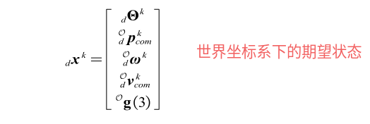

# 整个机器人的运行流程
  步骤一：遥控器控制四足机器人质心在机身坐标系下的VX、VY、WZ，将其转换为世界坐标系，并进行积分可求得质心在世界坐标系下的的期望位置X,Y以及偏航角Z（Z的期望位置为期望机身高度加上实际世界坐标系上Z的高度）
  
  步骤二：根据四足的足端位置，可求得足端平面方程，该方程对应的法向量可以作为机身的期望z轴，该法向量对应机身坐标系相对于世界坐标下的期望旋转矩阵的第三列，因此可以反求出期望世界坐标系下的机身的横滚角X和俯仰角Y,因此目前可以得到的数据如下图所示

